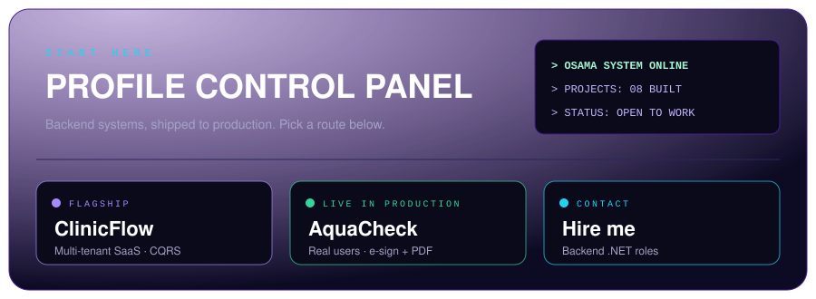
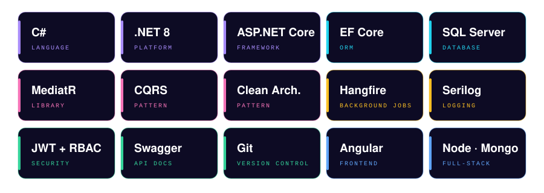
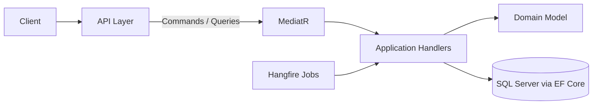

 

[ClinicFlow](https://github.com/Osama-matter/Clinic-appointment-management.git) &nbsp;|&nbsp; [MatterHub (Live)](https://mattar-dev.vercel.app/) &nbsp;|&nbsp; [All projects](#-projects) &nbsp;|&nbsp; [Contact](#-contact)

I'm a CS student and backend developer who builds **production-grade .NET systems**, not just CRUD APIs.
I design the domain model first, secure it with **JWT + RBAC**, and make it reliable with **background jobs and structured logging**.

- 🚀 **Shipped:** [MatterHub](https://mattar-dev.vercel.app/), a live platform serving real users
- 🏗️ **Building:** ClinicFlow, a multi-tenant SaaS for clinic management
- 🧠 **Principle:** *Make it work, make it right, make it fast, in that order.*

🌱 Learning next: Docker · Azure · Distributed systems patterns

### 🏥 [ClinicFlow: Multi-Tenant SaaS for Clinic Management](https://github.com/Osama-matter/Clinic-appointment-management.git)

> Enterprise-grade platform where each clinic (tenant) gets isolated data, roles and workflows.

| | |
|---|---|
| **Architecture** | Clean Architecture + CQRS (MediatR), fully multi-tenant |
| **Security** | JWT + fine-grained RBAC across tenant boundaries |
| **Reliability** | Hangfire background jobs, Serilog structured logging |
| **API** | 15+ documented REST endpoints (Swagger / OpenAPI) |

### 🌊 [AquaCheck Digital Platform](https://aquacheckdigitalplatform.runasp.net/)

> End-to-end operations platform for a dive center, **deployed and used by real users**.

- E-signature integration + automated PDF generation
- Centralized digital record management

`ASP.NET MVC` `PDF Generation` `Digital Signatures`

| Project | What it shows | Stack |
|---|---|---|
| 🍔 [**Food Delivery System**](https://github.com/Osama-matter/Delivery-System) | Clean Architecture + CQRS, JWT + role-based auth, full order & delivery lifecycle, Swagger docs | `ASP.NET Core 8` `EF Core` `SQL Server` |
| 🛍️ [**Mega Matter E-Commerce**](https://lnkd.in/gyXhnwnM) | Real payments (PayPal API v2), cart + checkout, 18,000+ lines, built in 3 weeks | `ASP.NET MVC` `PayPal` `Bootstrap` |
| 🎓 [**EduPlatform LMS**](https://github.com/Osama-matter/Educational_Platform_Backend) | Multi-role LMS: courses, student progress, multi-tier auth | `ASP.NET Core` `EF Core` `JWT` |
| 🏭 [**Industrix**](https://github.com/Osama-matter/Industrix) | Inventory microservice with real-time state, analytics and reporting endpoints | `Microservices` `.NET Core` `SQL Server` |
| 🏨 [**Hotel Booking API**](https://github.com/Osama-matter/Hotel-Bokking-System) | Reservation CRUD, JWT + RBAC, repository pattern | `REST API` `JWT` `EF Core` |
| 🚍 [**Transportation Booking**](https://github.com/AbdoSol1iman/Transportation-booking-) | Full-stack: atomic seat booking, RBAC, booking history | `Angular` `Node.js` `MongoDB` |

 

I'm looking for a **backend role (.NET)** where clean architecture and engineering discipline matter. 
If you're building something serious, let's talk.

